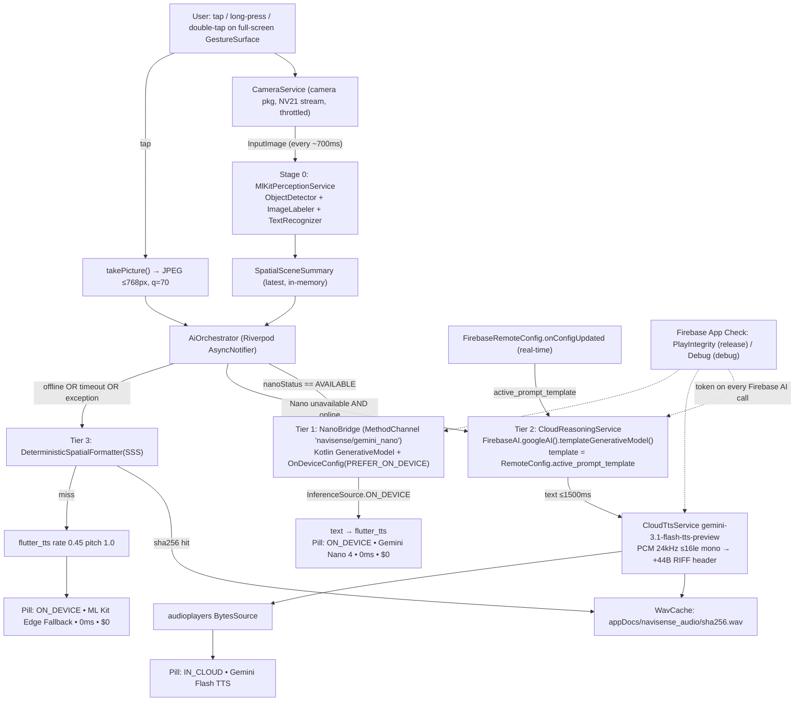
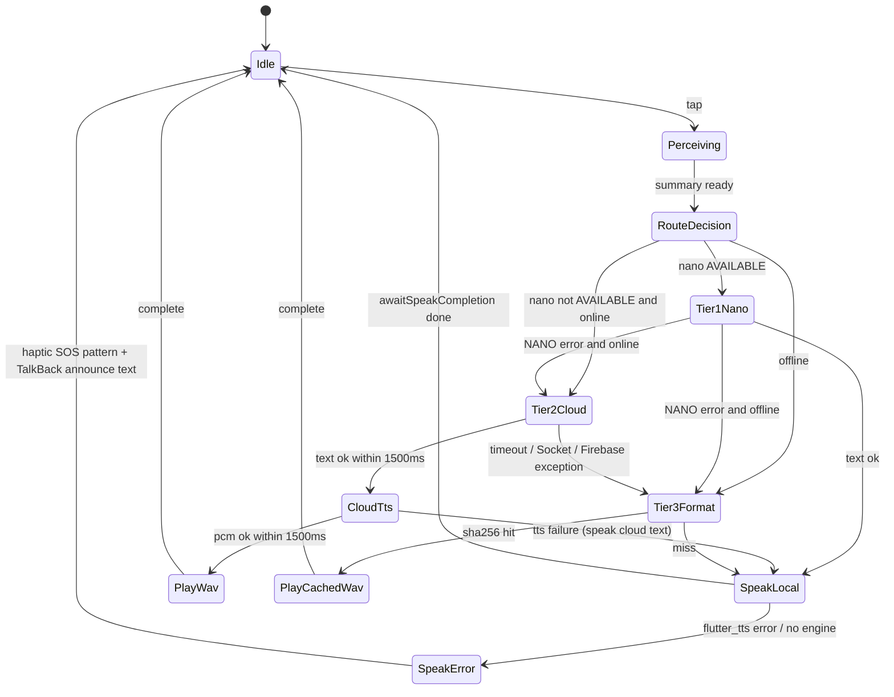

# 2 — Architecture (Android Mobile-Only)

> **Scope lock:** Flutter (Dart 3) UI/orchestration + native Android Kotlin `MethodChannel` bridge for Gemini Nano 4.
> **Forbidden:** any Web target, `dart:js_interop`, `package:web`, `idb_shim`, IndexedDB, `ReCaptchaEnterpriseProvider`, conditional `if (dart.library.js_interop)` exports.

---

## 2.1 Pinned Versions (November 2026)

### Flutter — `pubspec.yaml`

```yaml
name: navisense
description: Hybrid AI spatial guide for blind and low-vision users (Android).
publish_to: "none"
version: 1.0.0+1

environment:
  sdk: ">=3.5.0 <4.0.0"
  flutter: ">=3.27.0"

dependencies:
  flutter:
    sdk: flutter
  firebase_core: ^5.2.0          # pin to the version matching firebase_ai 5.2.x in the FlutterFire BoM
  firebase_ai: ^5.2.0
  firebase_app_check: any        # resolve to latest compatible with firebase_core; then pin exact in pubspec.lock
  firebase_remote_config: any    # same policy
  google_mlkit_object_detection: ^1.0.3
  google_mlkit_image_labeling: ^1.0.3
  google_mlkit_text_recognition: ^1.0.3
  camera: any
  flutter_riverpod: any
  flutter_tts: any
  audioplayers: any
  path_provider: any
  crypto: any

dev_dependencies:
  flutter_test:
    sdk: flutter
  flutter_lints: any
  mocktail: any
```

> **Pinning policy:** After the first successful `flutter pub get`, replace every `any` with the exact caret version from `pubspec.lock` and commit both files. No floating versions on the demo build.

### Android — `android/app/build.gradle.kts`

```kotlin
plugins {
    id("com.android.application")
    id("kotlin-android")
    id("dev.flutter.flutter-gradle-plugin")
    id("com.google.gms.google-services")
}

android {
    namespace = "com.navisense.app"
    compileSdk = 36

    defaultConfig {
        applicationId = "com.navisense.app"
        minSdk = 26
        targetSdk = 36
        versionCode = flutter.versionCode
        versionName = flutter.versionName
    }

    compileOptions {
        sourceCompatibility = JavaVersion.VERSION_17
        targetCompatibility = JavaVersion.VERSION_17
    }
    kotlinOptions { jvmTarget = "17" }

    buildTypes {
        release {
            isMinifyEnabled = true
            isShrinkResources = true
            proguardFiles(getDefaultProguardFile("proguard-android-optimize.txt"), "proguard-rules.pro")
            signingConfig = signingConfigs.getByName("debug") // replaced by upload key in Unit 10
        }
    }
}

flutter { source = "../.." }

dependencies {
    implementation(platform("com.google.firebase:firebase-bom:35.2.0"))
    implementation("com.google.firebase:firebase-ai")                       // 18.2.0 via BoM
    implementation("com.google.firebase:firebase-appcheck-playintegrity")   // 20.1.0 via BoM
    implementation("com.google.firebase:firebase-config")                   // 24.0.1 via BoM
    implementation("com.google.firebase:firebase-ai-ondevice:16.0.0-beta08") // pinned OUTSIDE BoM
    implementation("org.jetbrains.kotlinx:kotlinx-coroutines-android:1.9.0")
}
```

---

## 2.2 System Diagram



### ASCII (for terminals / code review)

```
┌───────────────────────────── Flutter (Dart) ─────────────────────────────┐
│ GestureSurface ─▶ CameraService ─▶ MlKitPerceptionService ─▶ SpatialSceneSummary
│        │                                                     │
│        └─tap─▶ JPEG snapshot ─▶ AiOrchestrator ◀──────────────┘
│                                   │      │        │
│                 ┌─────────────────┘      │        └───────────────┐
│                 ▼                        ▼                        ▼
│        NanoBridge (MethodChannel)  CloudReasoningService   DeterministicSpatialFormatter
│                 │                  + CloudTtsService               │
│                 │                  + WavCache (sha256)             ▼
│                 │                        │                 LocalTtsService / WavCache
│                 ▼                        ▼                        │
│           TelemetryNotifier ◀────────────┴────────────────────────┘
└─────────────────┬─────────────────────────────────────────────────────────┘
                  │ MethodChannel "navisense/gemini_nano"
                  │ EventChannel  "navisense/gemini_nano/download"
┌─────────────────▼──────────── Android (Kotlin) ──────────────────────────┐
│ MainActivity ─▶ GeminiNanoBridge ─▶ firebase-ai GenerativeModel           │
│                                     + OnDeviceConfig(PREFER_ON_DEVICE)    │
│                                     + GenerativeModel.OnDeviceExtension   │
│                                     (firebase-ai-ondevice:16.0.0-beta08)  │
│                                     ─▶ AICore ─▶ Gemini Nano 4 (NPU)      │
└──────────────────────────────────────────────────────────────────────────┘
```

---

## 2.3 Stage 0 — Google ML Kit Pre-Perception (All Devices)

### Detectors (created once, closed in `dispose()`)

| Detector | Config |
|---|---|
| `ObjectDetector` | `ObjectDetectorOptions(mode: DetectionMode.stream, classifyObjects: true, multipleObjects: true)` |
| `ImageLabeler` | `ImageLabelerOptions(confidenceThreshold: 0.65)` |
| `TextRecognizer` | `TextRecognizer(script: TextRecognitionScript.latin)` |

The three run **sequentially** on the same `InputImage`, not in parallel. On a 3 GB device, parallel inference spikes native heap. Budget: ≤ 50 ms total at 640×480 on a mid-range CPU. If a frame takes longer than 120 ms, the next frame is skipped automatically (busy flag).

### Spatial math

Let `W`, `H` = rotation-corrected frame dimensions and `b` = detected bounding box.

```
xCenterRatio = (b.left + b.width / 2) / W
direction    = xCenterRatio < 0.33 ? LEFT
             : xCenterRatio > 0.67 ? RIGHT
             : CENTER

areaRatio    = (b.width * b.height) / (W * H)
distance     = areaRatio >= 0.25 ? VERY_CLOSE
             : areaRatio >= 0.06 ? AHEAD
             : FAR
```

**Obstacle classification:** an object is an `Obstacle` when `distance == VERY_CLOSE`, or when `direction == CENTER && distance == AHEAD`. Everything else is an `Object`.

**Label fusion:** object detector labels are coarse ("Home good", "Fashion good"). When an object's own label is missing or generic, assign the highest-confidence `ImageLabeler` label (≥ 0.65) not already used. Unlabeled objects become `"object"`.

**Text:** keep `TextBlock`s whose bounding box area ratio is ≥ 0.005, take the top 3 by area, trim, collapse whitespace, max 40 chars each.

### `SpatialSceneSummary` contract

```dart
enum Direction { left, center, right }
enum Distance { veryClose, ahead, far }
enum EntityKind { obstacle, object }

final class SpatialEntity {
  const SpatialEntity({required this.kind, required this.label,
      required this.direction, required this.distance, required this.confidence});
  final EntityKind kind;
  final String label;
  final Direction direction;
  final Distance distance;
  final double confidence; // 0..1
}

final class SpatialSceneSummary {
  const SpatialSceneSummary({required this.entities, required this.texts,
      required this.capturedAt, required this.processingMs});
  final List<SpatialEntity> entities; // sorted: obstacles first, then by distance, then confidence
  final List<String> texts;
  final DateTime capturedAt;
  final int processingMs;

  /// Canonical prompt / cache serialization. MUST be deterministic.
  String toPromptString() => [
        ...entities.map((e) =>
            '[${e.kind == EntityKind.obstacle ? 'Obstacle' : 'Object'}: '
            '${e.label}, ${e.direction.name.toUpperCase()}, '
            '${switch (e.distance) { Distance.veryClose => 'VERY CLOSE', Distance.ahead => 'AHEAD', Distance.far => 'FAR' }} '
            '(${(e.confidence * 100).round()}%)]'),
        ...texts.map((t) => '[Text: "$t"]'),
      ].join(', ');
}
```

Example: `[Obstacle: Chair, CENTER, VERY CLOSE (88%)], [Object: Door, LEFT, AHEAD (79%)], [Text: "EXIT"]`

A summary is **stale** after 2 s. On tap, if the latest summary is stale, the orchestrator runs Stage 0 once on the snapshot JPEG (`InputImage.fromFilePath`).

---

## 2.4 Tier 1 — Gemini Nano 4 via Native Bridge

### Channel contract

| Channel | Method / Stream | Args | Returns |
|---|---|---|---|
| `navisense/gemini_nano` | `getStatus` | — | `"AVAILABLE" \| "DOWNLOADABLE" \| "DOWNLOADING" \| "UNAVAILABLE"` |
| `navisense/gemini_nano` | `startDownload` | — | `null` (progress via EventChannel) |
| `navisense/gemini_nano` | `generate` | `{jpeg: Uint8List, summary: String, systemInstruction: String}` | `{text: String, inferenceSource: "ON_DEVICE"\|"IN_CLOUD", latencyMs: int}` |
| `navisense/gemini_nano/download` | event stream | — | `{state: String, bytesDownloaded: int, totalBytes: int}` |

Errors are returned as `PlatformException(code: "NANO_UNAVAILABLE" | "NANO_TIMEOUT" | "NANO_FAILED", message)`.

### Kotlin reference (`GeminiNanoBridge.kt`)

```kotlin
package com.navisense.app

import android.graphics.BitmapFactory
import android.os.SystemClock
import com.google.firebase.Firebase
import com.google.firebase.ai.ai
import com.google.firebase.ai.type.GenerativeBackend
import com.google.firebase.ai.type.content
import com.google.firebase.ai.ondevice.OnDeviceConfig
import com.google.firebase.ai.ondevice.InferenceMode
import com.google.firebase.ai.type.InferenceSource
import io.flutter.plugin.common.EventChannel
import io.flutter.plugin.common.MethodCall
import io.flutter.plugin.common.MethodChannel
import kotlinx.coroutines.*

class GeminiNanoBridge(private val scope: CoroutineScope) :
    MethodChannel.MethodCallHandler, EventChannel.StreamHandler {

    private var downloadSink: EventChannel.EventSink? = null

    private val model by lazy {
        Firebase.ai(backend = GenerativeBackend.googleAI()).generativeModel(
            modelName = CLOUD_MODEL_FOR_HYBRID,
            systemInstruction = content { text(DEFAULT_SYSTEM_INSTRUCTION) },
            onDeviceConfig = OnDeviceConfig(mode = InferenceMode.PREFER_ON_DEVICE),
        )
    }

    override fun onMethodCall(call: MethodCall, result: MethodChannel.Result) {
        when (call.method) {
            "getStatus" -> scope.launch {
                runCatching { model.onDeviceExtension.checkStatus().name }
                    .onSuccess { result.success(mapStatus(it)) }
                    .onFailure { result.success("UNAVAILABLE") }
            }
            "startDownload" -> scope.launch {
                runCatching {
                    model.onDeviceExtension.download().collect { p ->
                        withContext(Dispatchers.Main) {
                            downloadSink?.success(mapOf(
                                "state" to p.state.name,
                                "bytesDownloaded" to p.bytesDownloaded,
                                "totalBytes" to p.totalBytes,
                            ))
                        }
                    }
                }.onFailure { e ->
                    withContext(Dispatchers.Main) { downloadSink?.error("NANO_FAILED", e.message, null) }
                }
                result.success(null)
            }
            "generate" -> scope.launch {
                val jpeg = call.argument<ByteArray>("jpeg")!!
                val summary = call.argument<String>("summary")!!
                val started = SystemClock.elapsedRealtime()
                try {
                    val bitmap = withContext(Dispatchers.Default) {
                        BitmapFactory.decodeByteArray(jpeg, 0, jpeg.size)
                    }
                    val response = withTimeout(NANO_TIMEOUT_MS) {
                        model.generateContent(content {
                            image(bitmap)                    // ImagePart
                            text("Scene: $summary")           // TextPart
                        })
                    }
                    bitmap.recycle()
                    result.success(mapOf(
                        "text" to (response.text ?: ""),
                        "inferenceSource" to
                            if (response.inferenceSource == InferenceSource.ON_DEVICE) "ON_DEVICE" else "IN_CLOUD",
                        "latencyMs" to (SystemClock.elapsedRealtime() - started).toInt(),
                    ))
                } catch (e: TimeoutCancellationException) {
                    result.error("NANO_TIMEOUT", "On-device inference exceeded ${NANO_TIMEOUT_MS}ms", null)
                } catch (e: Exception) {
                    result.error("NANO_FAILED", e.message, null)
                }
            }
            else -> result.notImplemented()
        }
    }

    override fun onListen(arguments: Any?, events: EventChannel.EventSink) { downloadSink = events }
    override fun onCancel(arguments: Any?) { downloadSink = null }

    private fun mapStatus(raw: String) = when (raw) {
        "AVAILABLE" -> "AVAILABLE"
        "DOWNLOADABLE" -> "DOWNLOADABLE"
        "DOWNLOADING" -> "DOWNLOADING"
        else -> "UNAVAILABLE"
    }

    companion object {
        const val NANO_TIMEOUT_MS = 4000L
        const val CLOUD_MODEL_FOR_HYBRID = "gemini-3-flash"
        const val DEFAULT_SYSTEM_INSTRUCTION =
            "You are NaviSense, a calm spatial guide for a blind pedestrian. " +
            "Reply in ONE or TWO short sentences. Mention the closest hazard first with its direction " +
            "(left, ahead, right) and distance (very close, a few steps, far). Read important signs. " +
            "Never describe colors or aesthetics unless safety-relevant. Never speculate."
    }
}
```

> **Verification gate (Unit 6):** The import paths and property names above (`onDeviceExtension`, `checkStatus()`, `download()`, `inferenceSource`) follow the API surface confirmed for `firebase-ai:18.2.0` + `firebase-ai-ondevice:16.0.0-beta08`. If they don't match when compiling, fix them against the official Firebase AI Logic Android reference. Do **not** fall back to the deprecated standalone `FirebaseAIOnDevice.checkStatus()` / `download()`.
>
> **CONTRACT CHANGE (Unit 6):** Verified at Kotlin compile time against `firebase-ai:18.2.0` + `firebase-ai-ondevice:16.0.0-beta08`: `OnDeviceConfig`, `InferenceMode`, `InferenceSource`, `OnDeviceModelStatus`, and `DownloadStatus` reside in `com.google.firebase.ai.*` (annotated `@PublicPreviewAPI`, requiring `@OptIn(PublicPreviewAPI::class)`); `model.onDeviceExtension` is nullable (`OnDeviceExtension?`); `checkStatus()` returns `OnDeviceModelStatus` (constants `AVAILABLE`/`DOWNLOADABLE`/`DOWNLOADING`/`UNAVAILABLE`); and `download()` emits sealed `DownloadStatus` subtypes (`DownloadStarted`, `DownloadInProgress`, `DownloadCompleted`, `DownloadFailed`). `GeminiNanoBridge.kt` also hosts `compressJpeg`, `getDeviceMemoryClass`, and `openAppSettings` on `"navisense/gemini_nano"`.

### Routing rule (who owns the cloud path?)

The **Dart orchestrator** is the only router. The Kotlin bridge is called **only when `getStatus() == AVAILABLE`**. This keeps every cloud call going through Remote-Config-governed **Server Prompt Templates** (Tier 2) instead of the bridge's hard-coded system instruction. If the bridge still reports `inferenceSource == IN_CLOUD` (for example, AICore evicted the model mid-session), the orchestrator accepts the text, labels the pill `IN_CLOUD`, and re-queries `getStatus` before the next request.

---

## 2.5 Tier 2 — Cloud Reasoning (Server Prompt Templates) + Cloud TTS

### Reasoning

> **CONTRACT CHANGE (Unit 7):** In `firebase_ai: 5.2.0`, `FirebaseAI.googleAI()` resolves `FirebaseAppCheck` automatically from the default `FirebaseApp` service registry rather than taking an `appCheck:` named parameter.

```dart
final templateModel = FirebaseAI.googleAI()
    .templateGenerativeModel();

final response = await templateModel
    .generateContent(
      remoteConfig.activePromptTemplate, // 'navisense_nav_prompt_v1' | 'navisense_nav_prompt_v2'
      inputs: {
        'scene': summary.toPromptString(),
        'image': 'data:image/jpeg;base64,${base64Encode(jpeg)}',
        'locale': 'en',
      },
    )
    .timeout(const Duration(milliseconds: 1500));
```

### Dotprompt templates (stored server-side in Firebase console — reference copies)

`navisense_nav_prompt_v1`:
```handlebars
---
model: googleai/gemini-3-flash
config:
  temperature: 0.2
  maxOutputTokens: 80
input:
  schema:
    scene: string
    image: string
    locale: string
---
{{role "system"}}
You are NaviSense, a calm spatial guide for a blind pedestrian. Reply in at most two short sentences.
State the closest hazard first with direction (left, ahead, right) and distance (very close, a few steps, far).
Read safety-relevant signs verbatim. Never speculate. Language: {{locale}}.
{{role "user"}}
On-device perception: {{scene}}
{{media url=image}}
```

`navisense_nav_prompt_v2` (clock-face style for the hot-swap demo):
```handlebars
---
model: googleai/gemini-3-flash
config:
  temperature: 0.2
  maxOutputTokens: 80
input:
  schema:
    scene: string
    image: string
    locale: string
---
{{role "system"}}
You are NaviSense. Use clock-face directions (12 o'clock is straight ahead, 9 is left, 3 is right)
and step counts (one step is about 0.7 m). Hazard first. Maximum two sentences. Language: {{locale}}.
{{role "user"}}
On-device perception: {{scene}}
{{media url=image}}
```

### Cloud TTS

```dart
final ttsModel = FirebaseAI.googleAI(appCheck: FirebaseAppCheck.instance).generativeModel(
  model: 'gemini-3.1-flash-tts-preview',
  generationConfig: GenerationConfig(
    responseModalities: [ResponseModalities.audio],
    speechConfig: SpeechConfig(voiceName: 'Kore'),
  ),
);
final res = await ttsModel
    .generateContent([Content.text('Say calmly and clearly: $guidanceText')])
    .timeout(const Duration(milliseconds: 1500));
final pcm = res.inlineDataParts.first.bytes; // raw s16le, 24000 Hz, mono
```

**Budget:** reasoning has 1500 ms, then TTS gets a separate 1500 ms. If reasoning succeeds and TTS fails, the cloud **text** is spoken via `flutter_tts`. The pill stays `IN_CLOUD` with suffix `• local voice`, because the reasoning was still cloud.

### 44-byte RIFF/WAV header (Little-Endian)

| Offset | Size | Field | Value (24 kHz, 16-bit, mono) |
|---:|---:|---|---|
| 0 | 4 | ChunkID | `"RIFF"` (ASCII, big-endian bytes) |
| 4 | 4 | ChunkSize | `36 + dataLen` (u32 LE) |
| 8 | 4 | Format | `"WAVE"` |
| 12 | 4 | Subchunk1ID | `"fmt "` |
| 16 | 4 | Subchunk1Size | `16` |
| 20 | 2 | AudioFormat | `1` (PCM) |
| 22 | 2 | NumChannels | `1` |
| 24 | 4 | SampleRate | `24000` |
| 28 | 4 | ByteRate | `SampleRate × NumChannels × BitsPerSample/8 = 48000` |
| 32 | 2 | BlockAlign | `NumChannels × BitsPerSample/8 = 2` |
| 34 | 2 | BitsPerSample | `16` |
| 36 | 4 | Subchunk2ID | `"data"` |
| 40 | 4 | Subchunk2Size | `dataLen` (= PCM byte count; must be even) |

Duration check: `seconds = dataLen / 48000`.

```dart
Uint8List pcmToWav(Uint8List pcm, {int sampleRate = 24000, int channels = 1, int bitsPerSample = 16}) {
  final dataLen = pcm.lengthInBytes - (pcm.lengthInBytes % 2); // drop dangling odd byte
  final byteRate = sampleRate * channels * bitsPerSample ~/ 8;
  final blockAlign = channels * bitsPerSample ~/ 8;
  final header = ByteData(44)
    ..setUint32(0, 0x52494646, Endian.big)      // "RIFF"
    ..setUint32(4, 36 + dataLen, Endian.little)
    ..setUint32(8, 0x57415645, Endian.big)      // "WAVE"
    ..setUint32(12, 0x666d7420, Endian.big)     // "fmt "
    ..setUint32(16, 16, Endian.little)
    ..setUint16(20, 1, Endian.little)
    ..setUint16(22, channels, Endian.little)
    ..setUint32(24, sampleRate, Endian.little)
    ..setUint32(28, byteRate, Endian.little)
    ..setUint16(32, blockAlign, Endian.little)
    ..setUint16(34, bitsPerSample, Endian.little)
    ..setUint32(36, 0x64617461, Endian.big)     // "data"
    ..setUint32(40, dataLen, Endian.little);
  return (BytesBuilder(copy: false)
        ..add(header.buffer.asUint8List())
        ..add(Uint8List.sublistView(pcm, 0, dataLen)))
      .takeBytes();
}
```

### SHA-256 WAV cache (`dart:io`)

- **Key:** `sha256(utf8('$voiceName|$ttsModel|${normalizedText}'))`. Normalization: lowercase, trim, collapse whitespace, strip trailing punctuation.
- **Path:** `${(await getApplicationDocumentsDirectory()).path}/navisense_audio/<hex>.wav`
- **Write:** atomic: write to `<hex>.wav.tmp`, then `rename` to `<hex>.wav`.
- **Eviction:** LRU by `lastModified`, cap **20 MB** or **200 files**. Evict on app start and after each write. Touch `setLastModified` on hit.
- **Tier 3 use:** the deterministic formatter's output is hashed with the *same* key function (voice `Kore`). A hit means a previously cloud-synthesized identical sentence plays with the high-fidelity voice even when offline.

Playback: `await player.play(BytesSource(wavBytes, mimeType: 'audio/wav'))` for fresh audio, `DeviceFileSource(path)` for cache hits (avoids loading into the Dart heap).

---

## 2.6 Tier 3 — Deterministic Edge Fallback

### Triggers (any one)
1. `ConnectivityProbe.isOffline == true` (DNS lookup of `firebasevertexai.googleapis.com` fails within 300 ms, cached 5 s) **and** Nano status ≠ `AVAILABLE`.
2. Tier 1 or Tier 2 throws `SocketException`, `TimeoutException`, `FirebaseException`, `PlatformException`, or `HttpException`.
3. Cloud reasoning returns empty or blocked text.

### Formatter (pure function, 100% unit-tested)

```
Rules, applied in order:
1. Obstacles with VERY_CLOSE → "Caution: {label} very close {dirPhrase}."
     dirPhrase: CENTER → "ahead in center", LEFT → "on your left", RIGHT → "on your right"
2. Remaining entities (max 2 total besides #1) →
     AHEAD → "{Label} {dirPhraseShort}." (CENTER → "ahead", LEFT → "on your left", RIGHT → "on your right")
     FAR   → "{Label} further {dirShort}." (CENTER → "ahead", LEFT → "to the left", RIGHT → "to the right")
3. Texts (max 2) → "Sign reads {TEXT}."
4. Empty summary → "Path looks clear. No objects detected."
Total output ≤ 4 sentences.
```

Golden example: `[Obstacle: Chair, CENTER, VERY CLOSE (88%)], [Object: Door, LEFT, AHEAD (79%)], [Text: "EXIT"]` → **"Caution: Chair very close ahead in center. Door on your left. Sign reads EXIT."**

---

## 2.7 Voice Failover State Machine



**Interrupt rule:** a new tap while speaking calls `flutterTts.stop()` and `player.stop()`, cancels the in-flight request (a generation counter drops stale results), then starts a new cycle.

**`flutter_tts` initialization (once, at startup):**
```dart
await tts.awaitSpeakCompletion(true);
await tts.setSpeechRate(0.45);
await tts.setPitch(1.0);
await tts.setVolume(1.0);
await tts.setLanguage('en-US');
final engines = await tts.getEngines; // detect Android Go without TTS engine
```
If `isLanguageInstalled('en-US')` is false, the UI shows a one-time banner: "Install offline voice data in Settings → Text-to-speech". The last-resort path is a `SemanticsService.announce`, so TalkBack reads the text through its own engine.

---

## 2.8 Firebase App Check

> **CONTRACT CHANGE (Unit 2):** `main.dart` calls `await Firebase.initializeApp()` without `options: DefaultFirebaseOptions.currentPlatform` so Android reads `android/app/google-services.json` resources via the Google Services Gradle plugin directly and committed Dart code never fails `flutter analyze` when gitignored `lib/firebase_options.dart` is absent.

```dart
await Firebase.initializeApp();
await FirebaseAppCheck.instance.activate(
  // Mandated semantics: AndroidProvider.debug in debug, AndroidProvider.playIntegrity in release.
  // In firebase_app_check versions exposing provider classes, these map to:
  providerAndroid: kDebugMode
      ? const AndroidDebugProvider(
          debugToken: String.fromEnvironment('APP_CHECK_DEBUG_TOKEN'))
      : const AndroidPlayIntegrityProvider(),
);
await FirebaseAppCheck.instance.setTokenAutoRefreshEnabled(true);
```

If the pinned `firebase_app_check` only exposes the enum (`androidProvider: AndroidProvider.debug`), the debug token is injected natively instead. In `MainActivity.onCreate`, before Flutter engine start, set `DebugAppCheckProviderFactory` and pass the token from `BuildConfig.APP_CHECK_DEBUG_TOKEN`. That value is filled from `secrets.json` via a Gradle task, debug variant only.

**`secrets.json` (gitignored):**
```json
{ "APP_CHECK_DEBUG_TOKEN": "00000000-0000-0000-0000-000000000000" }
```
**Run:** `flutter run --dart-define-from-file=secrets.json`

**Console:** App Check → Apps → Android → Play Integrity registered with the SHA-256 of the release/upload key. Debug tokens are added under "Manage debug tokens". **Firebase AI Logic** and **Remote Config** have enforcement **ON** before the demo.

---

## 2.9 Remote Config — Real-Time Prompt Governance

| Key | Type | Default | Purpose |
|---|---|---|---|
| `active_prompt_template` | String | `navisense_nav_prompt_v1` | Server Prompt Template ID for Tier 2 |
| `cloud_timeout_ms` | Number | `1500` | Reasoning + TTS timeout per stage |
| `tts_voice_name` | String | `Kore` | Cloud TTS voice |
| `enable_cloud_tts` | Boolean | `true` | Kill-switch for cloud TTS |

```dart
final rc = FirebaseRemoteConfig.instance;
await rc.setConfigSettings(RemoteConfigSettings(
  fetchTimeout: const Duration(seconds: 5),
  minimumFetchInterval: kDebugMode ? Duration.zero : const Duration(minutes: 5),
));
await rc.setDefaults(const {
  'active_prompt_template': 'navisense_nav_prompt_v1',
  'cloud_timeout_ms': 1500,
  'tts_voice_name': 'Kore',
  'enable_cloud_tts': true,
});
unawaited(rc.fetchAndActivate().catchError((_) => false)); // never block startup

_sub = rc.onConfigUpdated.listen((event) async {
  if (event.updatedKeys.isEmpty) return;
  await rc.activate();
  if (event.updatedKeys.contains('active_prompt_template')) {
    ref.read(promptTemplateProvider.notifier).set(rc.getString('active_prompt_template'));
    SemanticsService.announce('Guidance style updated', TextDirection.ltr);
  }
}, onError: (_) { /* offline: keep last activated values */ });
```

Allowed template IDs are whitelisted client-side (`{'navisense_nav_prompt_v1', 'navisense_nav_prompt_v2'}`). An unknown value falls back to v1 and logs a warning.

---

## 2.10 Data & Privacy

- Frames are **never written to disk** except the transient snapshot JPEG in `getTemporaryDirectory()`. It is deleted right after the request completes.
- No analytics SDK. No user accounts. No PII. Only cached WAVs persist, and they contain only synthesized guidance sentences.
- Camera permission rationale is spoken and shown before the request.
